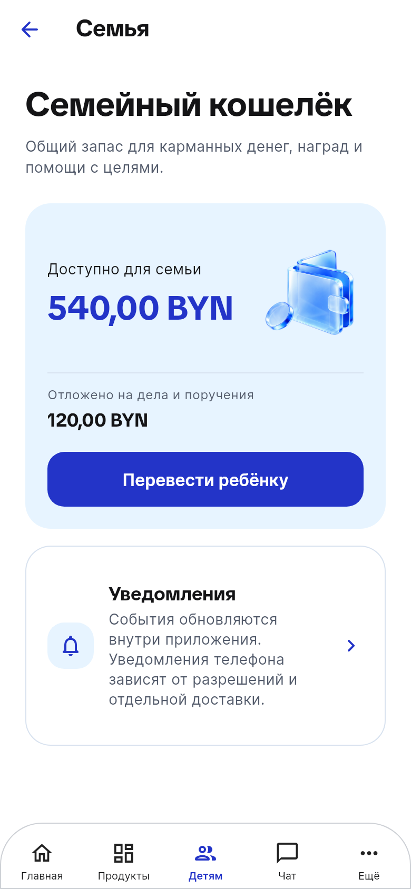
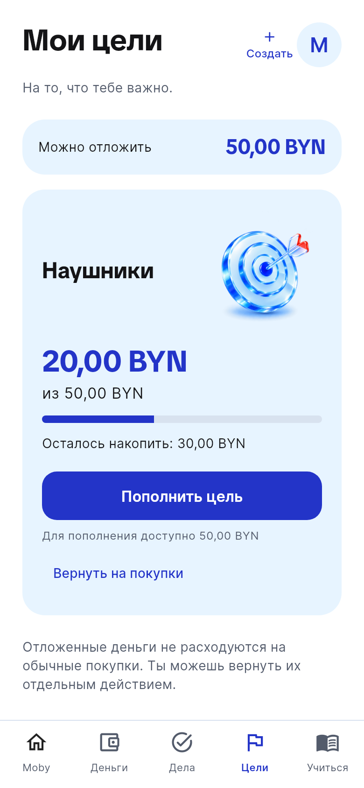
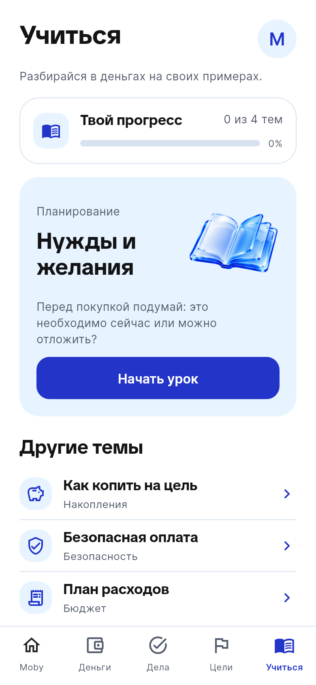
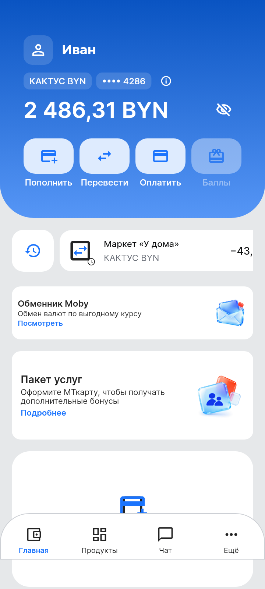
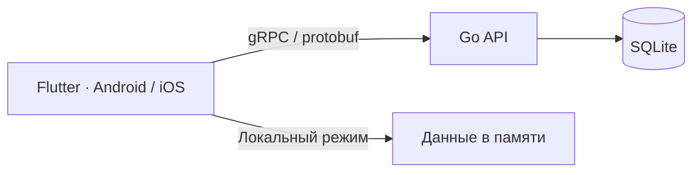
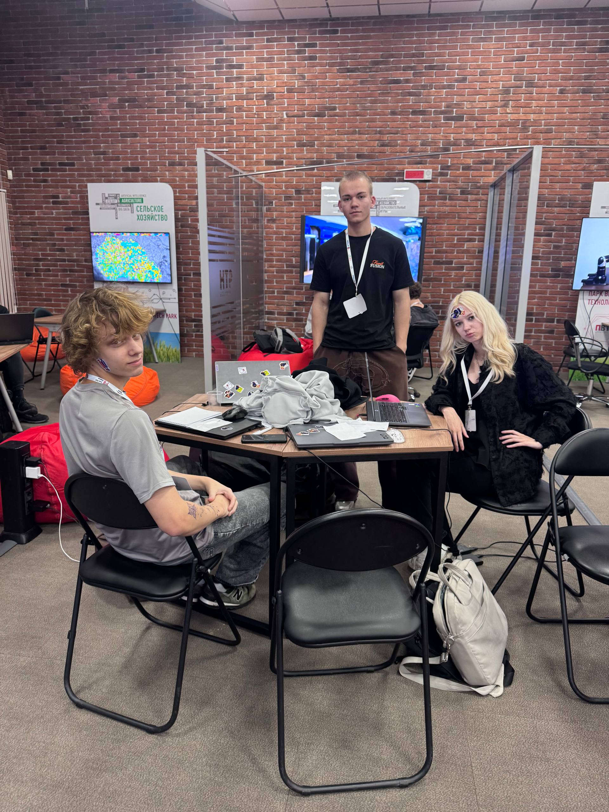
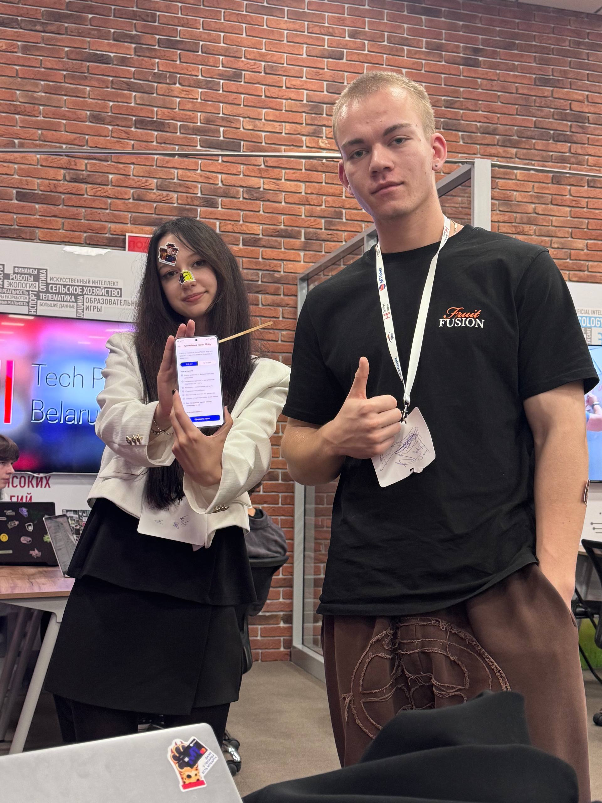

<a href="https://mtbankhackathon.by/"></a>

<div align="center">

# Moby Space

**Карманные деньги, цели и дела в одном семейном пространстве.**

<p align="center">
  <a href="docs/stack.md"></a>
</p>

<p align="center">
  <strong>Flutter 3.44.6 · Dart 3.12.2 · Go 1.27.3 · SQLite</strong>
</p>

<p align="center">
  <a href="#приложение"></a>
  <a href="#быстрый-запуск"></a>
  <a href="#сборки-android-и-ios"></a>
  <a href="#команда"></a>
</p>

</div>

Командный прототип детско-семейного банкинга для **Space Hackathon with МТбанк**.
Взрослый управляет бюджетом и правилами, ребёнок копит на цели, выполняет задания
и учится обращаться с деньгами. Flutter-клиент для Android и iOS, сервер на Go и SQLite.
Все деньги и банковские операции — демонстрационные.

## Приложение

**У взрослого — семейный бюджет. У ребёнка — свои деньги и цели.**

<p align="center">
  <a href="docs/assets/screenshots/family-overview.png"></a>
  <a href="docs/assets/screenshots/child-goals.png"></a>
  <a href="docs/assets/screenshots/child-learning.png"></a>
  <a href="docs/assets/screenshots/replica-home.png"></a>
</p>

Взрослый создаёт задание и назначает награду. Когда ребёнок принимает задание,
деньги резервируются; после выполнения взрослый подтверждает выплату. Накопления,
доступные деньги и резервы учитываются отдельно; повтор команды не создаёт вторую выплату.

Есть лимиты расходов, регулярные карманные выплаты, уроки с сохранением прогресса
и уведомления внутри приложения. [Подробнее о семейных сценариях →](docs/product/family-space-v2.md)

## Быстрый запуск

Нужны **Flutter 3.44.6 / Dart 3.12.2** и SDK выбранной платформы.
Из корня репозитория:

```sh
cd frontend
flutter pub get --enforce-lockfile
flutter run
```

**Без сервера** откроется локальная демоверсия: главная, продукты, формы,
история и чат. Данные живут в памяти и не синхронизируются между устройствами.

**С собственным API** доступен семейный режим: отдельные сеансы взрослого
и ребёнка, сохранение состояния в SQLite и синхронизация.
При сетевой ошибке он не переключается в локальный режим.

<details>
<summary><strong>Подключить семейный режим</strong></summary>

Запустите [API через Compose](deploy/README.md) или [Go backend](backend/README.md).
Для Android Emulator и gRPC-порта Compose:

```sh
flutter run --dart-define=MOBY_API_URL=http://10.0.2.2:19090
```

Первый вход взрослого требует собственного bootstrap secret. Он вводится
в приложении и не должен попадать в URL, сборку или Git.
[Адреса для iOS Simulator и физических устройств](frontend/README.md).

</details>

## Сборки Android и iOS

Общий workflow собирает **Android APK** на Linux и **iOS device IPA** на macOS.
Пакеты, SHA-256 и manifest с версией и исходным коммитом сохраняются в Actions artifacts.
Тег `v<version>` выпускает prerelease после проверок.

iOS IPA не подписана: для установки нужна собственная Apple identity.
Для Android предусмотрена временная или постоянная подпись.
Работа на физических устройствах проверяется отдельно.

<p align="center">
  <a href=".github/workflows/mobile-release.yml"></a>
  &emsp; <a href="docs/development/releases.md"><strong>Сборки и артефакты →</strong></a> &emsp;
  <a href=".github/workflows/ios-unsigned.yml"></a>
</p>

<p align="center">
  <a href="docs/development/android-signing.md">Android-подпись</a> · <a href="docs/development/ios-build.md">Установка iOS</a>
</p>

## Под капотом



Семейный клиент использует gRPC/HTTP2; REST/SSE сохранён для совместимости.
Сервер проверяет права и денежные ограничения до записи в SQLite.
Сеансы клиента хранятся через Keystore/Keychain.

<p align="center">
  <a href="docs/architecture.md"><strong>Архитектура →</strong></a> &emsp; <a href="docs/api/README.md"><strong>API →</strong></a> &emsp; <a href="docs/development/testing.md"><strong>Разработка и тесты →</strong></a>
</p>

<details>
<summary><strong>Каталоги и проверки</strong></summary>

- [frontend](frontend/README.md) — Flutter, экраны обоих режимов, gRPC и outbox.
- [backend](backend/README.md) — Go API, SQLite, семейные команды и потоки обновлений.
- [proto](proto/moby/family/v1/family.proto) — версионированный protobuf-контракт.
- [deploy](deploy/README.md) — переносимый пример локального запуска.
- [docs](docs/architecture.md) — архитектура, продуктовые правила и инструкции.
- [tools](tools/assets/README.md) — ресурсы, сборка и генерация контрактов.

[Source CI](.github/workflows/source-checks.yml) проверяет Flutter и Go, оба режима,
Go race detector, известные Go-уязвимости, генерацию контрактов и взаимодействие
Go/Dart-клиентов. Отдельный gate проверяет ссылки, происхождение и хеши локальных изображений.

```sh
python3 tools/check_repository.py --public
cd frontend
flutter analyze --fatal-infos
flutter test
```

[Стек](docs/stack.md) · [Технические решения](docs/decisions.md)

</details>

## Хакатон

**20–22 октября 2026 · Минск · стартап-центр ПВТ**

На Space Hackathon with МТбанк мы работали над детско-семейным банкингом:
самостоятельным пакетом услуг или решением внутри Moby.

<p align="center">
  <a href="https://mtbankhackathon.by/"></a> &emsp;&emsp;
  <a href="https://www.mtbank.by/"></a> &emsp;&emsp;
  <a href="https://park.by/"></a>
</p>

<p align="center">
  Организаторы: <a href="https://mtbankhackathon.by/">StartUp Space</a> и <a href="https://park.by/">Парк высоких технологий</a><br>
  Генеральный партнёр: <a href="https://www.mtbank.by/">МТбанк</a>
</p>

<p align="center">
  <a href="https://mtbankhackathon.by/"><strong>О хакатоне →</strong></a> &emsp; <a href="https://spacemedia.by/news/chetvyortyj-hakaton-i-rekordnyj-interes-kak-proshyol-space-hackathon-with-mtbank-4-0/"><strong>Репортаж Space Media →</strong></a>
</p>

## Команда

<p align="center">
  <a href="docs/assets/team/team-at-hackathon.jpg"></a>
  <a href="docs/assets/team/prototype-on-phone.jpg"></a>
</p>

Над Moby Space работали:

<p align="center">
  <a href="https://github.com/knyazin47"></a>
  <a href="https://github.com/lolmmmtech"></a>
  <a href="https://github.com/zhalobitskaia"></a>
  <a href="https://github.com/koloideal"></a>
  <a href="https://github.com/Armovit"></a>
</p>

<p align="center">
  <a href="https://github.com/knyazin47">knyazin47</a> · <a href="https://github.com/lolmmmtech">lolmmmtech</a> · <a href="https://github.com/zhalobitskaia">zhalobitskaia</a> · <a href="https://github.com/koloideal">koloideal</a> · <a href="https://github.com/Armovit">Armovit</a>
</p>

<p align="center">
  <a href="AUTHORS.md"><strong>Участники проекта →</strong></a> &emsp; <a href="CONTRIBUTING.md"><strong>Как внести вклад →</strong></a>
</p>

## Статус и лицензия

Это хакатонный прототип на один демонстрационный семейный стенд.
Настоящих платежей, SMS/KYC,, выпуска счетов и карт нет. Уведомления работают
внутри приложения; OS push и автоматические возрастные переходы не реализованы.
[Границы данных и доступа](docs/product/safety-boundaries.md).

Код и документация — **[MIT](LICENSE)**. У фотографий и сторонних ресурсов
[отдельные условия](NOTICE.md); [источники изображений](docs/assets/README.md)
собраны отдельно.
